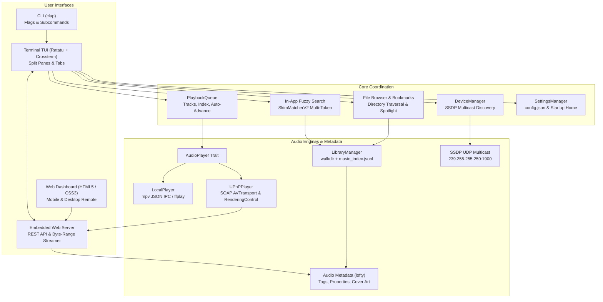

# Quickstream

A lightweight, blazing-fast terminal music player and DLNA / UPnP network streamer written in Rust.

Quickstream allows you to browse, search, and stream **FLAC**, **MP3**, **WAV**, **AAC**, **AIFF**, **OGG**, and **Opus** audio files directly to your network stereos, AVRs, or smart speakers without clunky desktop apps, or play them locally with zero UI latency.

It features a native **Ratatui** interactive terminal UI, an in-app recursive **fuzzy search** engine, an **embedded web dashboard** for complete mobile and desktop remote control, and a zero-latency audio engine powered by **mpv JSON IPC** and **UPnP / DLNA**.

---

## Table of Contents

- [Features](#features)
- [Architecture & Module Structure](#architecture--module-structure)
  - [Module Map](#module-map)
  - [System Architecture Diagram](#system-architecture-diagram)
  - [Concurrency & Threading Model](#concurrency--threading-model)
- [Playback & Streaming Logic](#playback--streaming-logic)
  - [Local Playback Engine (mpv IPC)](#local-playback-engine-mpv-ipc)
  - [DLNA / UPnP Network Streaming](#dlna--upnp-network-streaming)
  - [HTTP Byte-Range Audio Server](#http-byte-range-audio-server)
- [Library Indexing & Search Engine](#library-indexing--search-engine)
- [Web Interface & Remote Control Dashboard](#web-interface--remote-control-dashboard)
- [Prerequisites & System Dependencies](#prerequisites--system-dependencies)
- [Building & Installation](#building--installation)
- [CLI Startup Commands & Options](#cli-startup-commands--options)
- [Interactive Terminal Controls & Keybindings](#interactive-terminal-controls--keybindings)
- [Configuration & File Locations](#configuration--file-locations)
- [Testing & Quality Verification](#testing--quality-verification)
- [License](#license)

---

## Features

- **Blazing Fast Native Rust Performance**:
  - Built with Rust 2021 edition and [Ratatui](https://github.com/ratatui/ratatui) + [Crossterm](https://github.com/crossterm-rs/crossterm).
  - Instantaneous UI rendering, sub-millisecond hotkey response, and minimal CPU/memory footprint.

- **Dual Playback Architecture**:
  - **Local Audio**: Non-blocking local playback engine via `mpv` JSON-RPC IPC socket with dedicated reader thread, with seamless fallback to headless `ffplay`.
  - **Network Streaming**: Native SSDP multicast discovery (`239.255.255.250:1900`) for UPnP / DLNA MediaRenderers (Sonos, Primare, Denon, Marantz, KEF, etc.) with SOAP remote transport controls.

- **Interactive 4-Tab Terminal Interface**:
  - **Tab 1 (`[1] Now Playing`)**: Dedicated large-format hero display featuring prominent track typography (large title, artist, album), technical format badges (`[FLAC]`, `[24-bit / 96kHz]`, `[Stereo]`), full-width scrubbable timeline with progress percentage, file path details, and "Up Next" queue preview.
  - **Tab 2 (`[2] Queue & Library`)**: Dual-pane split view featuring an in-place **File Browser** on the left (with persistent directory bookmarks / "Music Homes" and metadata tag toggle `[v]`) and the active **Playback Queue** on the right. Focus toggled with `h` and `l`.
  - **Tab 3 (`[3] Devices`)**: Lists all discovered network DLNA MediaRenderers alongside **Local Audio** with live active indicator (`●`) and one-key output switching.
  - **Tab 4 (`[4] Settings`)**: User preferences editor for metadata display, audio backend, seek jump interval, volume step size, queue mode, PCM transcoding, web server toggle, and startup home directory.
  - **Persistent Bottom Playback Bar**: Always visible across all tabs with status badge (`▶`, `⏸`, `⏹`), track title, artist, album, format badge (codec, bitrate, sample rate, channels), volume level, elapsed/total time, and interactive progress bar.
  - **Overlay Help Modal (`?`)**: Full keyboard shortcut cheat-sheet that can be toggled on demand without disrupting playback or navigation.

- **High-Performance Search**:
  - **In-App Fuzzy Search (`f`)**: Recursive directory search across your entire collection using `fuzzy-matcher` (`SkimMatcherV2`) with streaming background scanner, live preview details card, and non-blocking multi-field matching.
  - **In-Place Spotlight (`/`)**: Instant inline subfolder and track filtering within the active browser view.

- **Embedded Web Dashboard (`--web`)**:
  - Responsive, modern HTML5/CSS3 single-page dashboard with blurred ambient lighting and zero external web dependencies.
  - **Now Playing**: High-resolution album artwork, interactive scrubbable timeline, playback controls, format badges, and volume slider.
  - **Queue Management**: View, tap-to-play, remove tracks, clear queue, and toggle playback loop modes.
  - **Library Browser**: Navigate files and folders, access bookmarked Music Homes, live text search, add single songs or click `[ Add All ]` to enqueue entire albums.
  - **Output Device Switcher**: Switch between Local Audio and network DLNA speakers with a single tap.

- **Intelligent Autopilot & DJ Mixes**:
  - **Progressive Multi-Threaded Scanning**: Instant playback start (< 50ms) with background candidate discovery streaming into the queue.
  - **Fair Multi-Artist Sampling**: Guarantees diversity across thousands of artist folders without letting single large discographies dominate.
  - **DJ Sequencing Rules**: Prevents back-to-back repetitions with an 8-track artist cooldown and 12-track album cooldown.
  - **Camelot Harmonic Mixing & BPM Flow**: Sequences transitions using Camelot wheel harmonic key compatibility and smooth tempo gradients.
  - **Mix Profiles (`M`)**: Diverse Shuffle, BPM Flow, Chill & Ambient, Workout & High Energy, and Late Night Groove.
  - **Seed Radio (`r`)**: Launches dynamic stations seeded by any track in your library or queue.
  - **Continuous Gapless UPnP Streaming**: Optional continuous PCM WAV stream (served at a per-session `/stream/continuous-<id>.wav` path) for seamless gapless playback on UPnP/DLNA stereos.
  - **Zero-Touch SQLite Feature Store**: Acoustical features and tags stored in `~/.cache/quickstream/track_analysis.db` without ever writing to your music storage.

- **Configurable Startup Home Directory**:
  - Set a default startup music directory via CLI (`quickstream --set-home <PATH>`), TUI hotkey (`H`), TUI Settings tab, or the Web Dashboard (`[ Set Home ]`).
  - Jump directly to home from anywhere with `~` (TUI) or `[ 🏠 Home ]` (Web).

- **XDG Specification Compliance**:
  - Standard user directories: `~/.config/quickstream/`, `~/.cache/quickstream/`, `~/.local/share/quickstream/`.
  - Automated backwards-compatible migration for legacy configurations (`~/.quickstream_*.json`, macOS `~/Library/Application Support/quickstream/`) into `~/.config/quickstream/`. Skipped when `XDG_CONFIG_HOME` points elsewhere; legacy files are only read, never written.

---

## Architecture & Module Structure

### Module Map

```
quickstream/
├── Cargo.toml            # Package manifest and native Rust dependencies
├── src/
│   ├── main.rs           # CLI argument parsing (clap), subcommands, signal traps, app bootstrap
│   ├── lib.rs            # Library entrypoint and module exports
│   ├── ui/
│   │   ├── mod.rs        # Ratatui event loop, render passes, tab switching, hotkeys, web sync
│   │   └── search.rs     # SearchModalState, live SkimMatcherV2 fuzzy filtering, preview card
│   ├── player/
│   │   ├── mod.rs        # AudioPlayer trait definition (play, pause, resume, stop, seek, volume)
│   │   ├── local.rs      # LocalPlayer: mpv JSON IPC listener thread & ffplay subprocess fallback
│   │   └── upnp.rs       # UPnPPlayer: SOAP XML generation, AVTransport / RenderingControl client
│   ├── analysis/
│   │   ├── mod.rs        # Analysis module exports & MixProfile definitions
│   │   ├── bpm.rs        # Peak-picking autocorrelation BPM detection
│   │   ├── harmonic.rs   # Musical key parsing and Camelot wheel compatibility scoring
│   │   ├── mixer.rs      # DjMixer::sequence_mix (harmonic flow, BPM gradient, artist/album spacing)
│   │   ├── db.rs         # SQLite persistent feature store (~/.cache/quickstream/track_analysis.db)
│   │   └── online.rs     # Metadata/tag enrichment via ureq HTTP client
│   ├── discovery.rs      # SSDP UDP multicast (239.255.255.250:1900), XML device parsing, DeviceManager
│   ├── library.rs        # walkdir directory indexing, jsonl cache persistence, progressive autopilot
│   ├── metadata.rs       # lofty metadata extraction (tags, duration, audio properties, cover art)
│   ├── queue.rs          # PlaybackQueue: ordered track list, cursors, auto-advance, reordering
│   ├── web.rs            # Embedded web server, byte-range streaming, continuous WAV, REST API, Web UI
│   ├── web_access.rs     # Web access control: pairing token, Host/Origin checks, allowed folders
│   ├── settings.rs       # Preferences model, cycle definitions, JSON persistence (~/.config/quickstream/config.json)
│   ├── paths.rs          # XDG Base Directory resolution and legacy dotfile migration
│   └── logger.rs         # Rotating file logger (~/.local/share/quickstream/quickstream.log)
└── tests/
    ├── test_autopilot.rs # Autopilot progressive streaming, candidate gathering, DJ mix profiles
    ├── test_browser.rs   # Browser navigation, caching, bookmarks, and modal lifecycle tests
    ├── test_discovery.rs # SSDP discovery packet parsing and device extraction tests
    ├── test_local_player.rs # mpv IPC and ffplay backend lifecycle tests
    ├── test_metadata.rs  # Audio metadata tag extraction and format verification tests
    ├── test_now_playing.rs # Now Playing hero layout, key navigation, and buffer render tests
    ├── test_search.rs    # Streaming scanner, fuzzy matching, and multi-field ranking tests
    ├── test_upnp.rs      # SOAP XML envelope generation, time formatting, and player tests
    └── test_web.rs       # Web server REST endpoints, byte-range streaming, actions, and browser tests
```

### System Architecture Diagram



### Concurrency & Threading Model

Quickstream is architected for zero UI latency. Heavy operations never run on the terminal event loop:

1. **Terminal UI Thread**: Drives Ratatui drawing and Crossterm input events with a 100ms poll timeout.
2. **Local Audio IPC Thread**: A dedicated reader thread maintains a continuous Unix domain socket connection to `mpv`. It observes `time-pos`, `duration`, `pause`, and `eof-reached` events, updating thread-safe atomic state. The UI thread reads playback state via lock-free memory accesses with 0ms socket latency.
3. **SSDP Multicast Discovery Thread**: Runs asynchronous UDP scans on `239.255.255.250:1900`, fetching device XML descriptions with timeout guards without blocking tab navigation.
4. **Background Library Scanner**: Streams discovered audio tracks from disk via an `mpsc::channel` in batches of 50, allowing the fuzzy search modal to open instantly while scanning proceeds in the background.
5. **Background Metadata Worker**: Extracts ID3/FLAC metadata tags in a separate worker thread for directories being browsed.
6. **Embedded Web Server Thread**: Runs a lightweight, multi-client HTTP server handling concurrent status polling, cover art delivery, and audio byte-range streaming.

---

## Playback & Streaming Logic

### Local Playback Engine (mpv IPC)

- When playing locally, Quickstream launches `mpv` in headless mode (`--no-video`, `--idle`, `--input-ipc-server=<SOCKET>`).
- IPC communication uses line-delimited JSON-RPC over the IPC socket.
- Commands (`loadfile`, `seek`, `pause`, `stop`, `volume`) are sent fire-and-forget directly to the socket.
- Position, duration, and pause states are observed continuously by the reader thread. If `mpv` is unavailable on the system, Quickstream automatically falls back to `ffplay` subprocess playback.

### DLNA / UPnP Network Streaming

- Quickstream discovers network renderers via SSDP `M-SEARCH` queries for `urn:schemas-upnp-org:device:MediaRenderer:1` and `urn:schemas-upnp-org:service:AVTransport:1`.
- When streaming to a network player, Quickstream sends SOAP XML envelopes to the device's control URL:
  - `SetAVTransportURI`: Instructs the stereo to stream the track from Quickstream's built-in HTTP server (`http://<local-ip>:<port>/stream/<filename>`).
  - `Play` / `Pause` / `Stop` / `Seek`: Controls playback states using standard UPnP `REL_TIME` timecodes (`HH:MM:SS`).
  - `SetVolume` / `GetVolume`: Controls hardware volume via the `RenderingControl` service.
- Includes DIDL-Lite XML metadata inside `CurrentURIMetaData` so your stereo's screen displays the song title, artist, album, format, and bitrate.

### HTTP Byte-Range Audio Server

Network stereos require HTTP Byte-Range support (`206 Partial Content`) to buffer and seek within audio streams:
- The streaming server resolves requests against an internal file registry and supports standard `Range: bytes=start-end` headers.
- **DLNA Profiles**: Streams are served with mandatory DLNA headers (`transferMode.dlna.org: Streaming`, `contentFeatures.dlna.org`).
- **Clean Socket Teardown**: When a track changes or playback stops, active streaming TCP sockets are forcefully closed (`shutdown(Both)`), cleanly terminating connections and preventing stereos from playing leftover buffer data.

---

## Library Indexing & Search Engine

Quickstream features a high-performance library engine designed to scale smoothly from small collections to 100,000+ tracks:

1. **Persistent Metadata Cache**:
   - Indexed metadata is saved to `~/.cache/quickstream/music_index.jsonl`.
   - On subsequent launches, files matching the cached path and modification size skip disk re-probes entirely.
2. **In-App Fuzzy Search (`f`)**:
   - Built on `fuzzy-matcher = "0.3"` (`SkimMatcherV2`).
   - Recursively walks subdirectories starting from the current browser location (or highlighted bookmark).
   - Searches across **Title**, **Artist**, **Album**, **Filename**, and **Path** simultaneously.
   - Live query input with match count, formatted result list, and right-hand metadata preview card.
3. **Directory Spotlight (`/`)**:
   - Provides quick, in-place filtering for the current folder view, jumping selection directly to matching items.

---

## Web Interface & Remote Control Dashboard

Launch Quickstream with `--web` (or enable it in Tab 3 Settings) to run the local HTTP web dashboard (default: `http://localhost:8080`).

```bash
quickstream --web
quickstream --web --web-port 3000
```

By default the dashboard only accepts connections from this computer (`127.0.0.1`). To open it from a phone or another device, set **Web Remote Access** to *Any device on your network* in Tab 4 (`[4] Settings`). While a DLNA speaker is the active output, the server always listens on the network so the speaker can fetch the audio stream.

### Access & Pairing
- **This computer**: open `http://localhost:<port>` (or `http://127.0.0.1:<port>`); no pairing needed. Requests must use one of those loopback names, so other websites cannot reach the dashboard through DNS tricks.
- **Other devices**: with *Any device on your network* enabled, the **Now Playing Web Server** row in Tab 4 (`[4] Settings`) shows a pairing link such as `http://192.168.1.20:8080/?token=…`. Open it once on your phone; it stores a session cookie and redirects to the dashboard. Until then the dashboard and API answer `401`. Scripts can send `Authorization: Bearer <token>` instead.
- The token is stored in `~/.config/quickstream/web_token` (readable only by you) and stays the same across restarts, so a bookmark keeps working. Delete the file and restart Quickstream to revoke all paired devices.
- DLNA speakers fetch `/stream/…` without a token; that path only serves tracks Quickstream has queued.
- The dashboard's file browser and folder actions are limited to your startup home directory, your bookmarks (Music Homes) and the folder Quickstream opened at launch.
- Control requests must be same-origin JSON (`Content-Type: application/json`), and the API sends no CORS headers, so other web pages cannot control playback or read your library.

### Dashboard Tabs
1. **Now Playing**:
   - Displays real-time track metadata, codec, bitrate, sample rate, and channels.
   - Embedded cover art extracted directly from ID3v2 APIC or FLAC PICTURE blocks (with fallback to folder artwork or procedural SVG).
   - Interactive progress bar with click-to-seek and touch scrubbing.
   - Skip forward/backward, play/pause, seek ±10s, volume slider, and "Up Next" preview.
2. **Queue Management**:
   - Complete playlist view showing track order, titles, artists, and durations.
   - Click any track to immediately switch playback to that song.
   - Delete individual songs (`✕`) or clear the entire queue with one click.
   - Cycle queue playback mode (`Continuous`, `Stop at End`, `Repeat 1`).
3. **Library / File Browser**:
   - Interactive breadcrumb directory navigation.
   - Music Homes bookmark chips for one-tap jumps to favorite folders.
   - Instant file and folder search filtering.
   - Tap any folder to enter; click `+` on any audio file to enqueue it; click `[ ＋ Add All ]` to enqueue all audio files in the folder at once.
   - **`[ 🏠 Home ]`**: Jump straight to your configured startup home directory.
   - **`[ Set Home ]`**: Highlights when inside your startup home folder; click to toggle or set the current directory as your default startup home.
4. **Output Devices**:
   - Lists Local Audio and all network DLNA stereos.
   - Switch active playback output with a single tap.
   - Trigger a live network rescan with real-time feedback.

### REST API Endpoints
- `GET /api/status`: Returns full playback state, queue items, device list, volume, and playback mode as JSON.
- `GET /api/cover`: Returns raw cover art image (JPEG/PNG) or SVG placeholder.
- `GET /api/browser?path=<PATH>`: Returns directory contents, bookmarks, parent path, and configured home directory.
- `POST /api/action`: Sends remote commands (`toggle_pause`, `play`, `pause`, `next`, `prev`, `volume`, `seek`, `seek_relative`, `play_index`, `remove_index`, `clear_queue`, `add_file`, `add_folder`, `select_device`, `rescan_devices`, `set_queue_mode`, `set_home`).
- `GET /stream/<FILENAME>`: Streams audio files with HTTP byte-range (`206 Partial Content`) support.

---

## Prerequisites & System Dependencies

- **Rust**: Version 1.75 or higher (`cargo` and `rustc`).
- **Audio Playback Backend**:
  - **`mpv` (Recommended)**: For local JSON-RPC IPC playback.
    - macOS: `brew install mpv`
    - Linux (Ubuntu/Debian): `sudo apt install mpv`
    - Linux (Arch): `sudo pacman -S mpv`
    - Linux (Fedora): `sudo dnf install mpv`
  - **`ffmpeg` / `ffplay` (Fallback)**: Used if `mpv` is not installed, and for audio format transcoding.
    - macOS: `brew install ffmpeg`
    - Linux: `sudo apt install ffmpeg`

---

## Building & Installation

### Clone the Repository
```bash
git clone https://github.com/jasonmarkperez/quickstream.git
cd quickstream
```

### Build Debug Binary
```bash
cargo build
./target/debug/quickstream
```

### Build Optimized Release Binary
```bash
cargo build --release
./target/release/quickstream
```

### Install to System PATH
```bash
cargo install --path .
```
This installs the `quickstream` binary to your Cargo bin directory (typically `~/.cargo/bin/quickstream`). Ensure `~/.cargo/bin` is in your `$PATH`.

---

## CLI Startup Commands & Options

Quickstream provides a versatile command-line interface:

```
Usage: quickstream [OPTIONS] [PATHS]...

Arguments:
  [PATHS]...  Audio files or directories to load

Options:
      --info <INFO>              Inspect audio metadata tags and exit
      --scan                     Scan local network for DLNA / UPnP MediaRenderers
      --web                      Launch local Now Playing web server (HTTP metadata, cover art & remote control)
      --web-port <WEB_PORT>      Port for Now Playing web server (default: 8080)
      --set-home <SET_HOME>      Set persistent startup home directory and exit (use "default" or "none" to clear)
  -a, --autopilot [<AUTOPILOT>]  Autopilot mode: recursively discover all audio tracks, build random queue, and start playing immediately
  -h, --help                     Print help
  -V, --version                  Print version
```

### Command Examples

```bash
# 1. Launch interactive TUI in your configured home directory (or current directory)
quickstream

# 2. Launch interactive TUI in a specific directory
quickstream ~/Music/Jazz/

# 3. Pre-load specific tracks into the queue and start playing
quickstream song1.flac song2.mp3 song3.wav

# 4. Launch interactive TUI with the Now Playing web server enabled
quickstream --web

# 5. Launch web server on a custom port
quickstream --web --web-port 3000

# 6. Configure your default startup home directory
quickstream --set-home ~/Music/FLAC
# Output: Startup home directory set to: /Users/username/Music/FLAC

# 7. Clear startup home directory (reverts to launch directory)
quickstream --set-home none
# Output: Startup home directory cleared (defaulting to launch directory).

# 8. Scan local Wi-Fi / Ethernet network for DLNA renderers and exit
quickstream --scan
# Output:
# Scanning network for DLNA MediaRenderers (SSDP)...
# Discovered audio outputs:
#   [0] Local Audio (mpv/ffplay)
#   [1] Primare I15 Prisma (192.168.1.145:8080)
#       Control: http://192.168.1.145:8080/AVTransport/control
# Scan complete (2 device(s) found).

# 9. Inspect audio file metadata tags and exit
quickstream --info "01 - Starlight.flac"
# Output:
# --- Audio Metadata (FLAC) ---
# File:        /Users/username/Music/01 - Starlight.flac
# Title:       Starlight
# Artist:      Muse
# Album:       Black Holes and Revelations
# Genre:       Alternative Rock
# Duration:    04:00
# Bitrate:     1024 kbps
# Sample Rate: 44100 Hz
# Channels:    2
# Size:        29.40 MB
```

---

## Interactive Terminal Controls & Keybindings

Press **`?`** anywhere inside Quickstream to open the interactive help modal.

### Global Playback Controls
| Key | Action |
| :--- | :--- |
| `Space` | Play / Pause active track (starts queue if stopped) |
| `s` | Stop audio playback |
| `←` / `→` | Skip to Previous / Next track in queue |
| `[` / `]` | Seek backward 10s / forward 10s |
| `+` / `-` | Increase / Decrease volume |
| `1` / `2` / `3` / `4` | Jump directly to Tab 1 (Now Playing), Tab 2 (Queue & Library), Tab 3 (Devices), or Tab 4 (Settings) |
| `n` / `N` | Toggle between **Now Playing** (`[1]`) and **Queue & Library** (`[2]`) |
| `Tab` | Switch between tabs sequentially |
| `?` | Toggle Help modal cheat-sheet |
| `q` / `Esc` / `Ctrl+C` | Quit Quickstream safely |

### Navigation & List Controls
| Key | Action |
| :--- | :--- |
| `h` / `l` | Switch focus between **Browser** (left) and **Queue** (right) panes |
| `j` / `k` (or `↓` / `↑`) | Move selection down / up (wraps around circularly) |
| `J` / `K` (or `PgDown` / `PgUp`) | Scroll list down / up by 15 items |
| `g` / `G` (or `Home` / `End`) | Jump to top / bottom of list |
| `Backspace` | Navigate to parent directory |
| `~` | Jump directly to configured startup home directory |
| `r` | Refresh contents of current folder |

### Library & Queue Actions
| Key | Action |
| :--- | :--- |
| `Enter` | Enter folder / Add song to queue / Play highlighted queue track |
| `a` | Enqueue all supported audio files in current folder |
| `b` | Bookmark current folder to "Music Homes" |
| `H` | Set or clear current folder as the persistent startup home directory |
| `v` | Toggle file list display mode between **Metadata (Tags)** and **Filename** |
| `d` / `x` | Remove highlighted track from queue, or delete highlighted bookmark |
| `c` | Clear entire queue (when queue pane is focused) |

### Search & Discovery Actions
| Key | Action |
| :--- | :--- |
| `f` | Open in-app recursive **Fuzzy Search** modal |
| `/` | Open in-place **Spotlight** directory filter |
| `r` | Rescan for DLNA network renderers (in Devices tab) |

### Search Modal Controls
| Key | Action |
| :--- | :--- |
| `Type text` | Real-time fuzzy query filtering |
| `Enter` | Immediately play highlighted match |
| `Tab` | Enqueue highlighted match without stopping playback |
| `Ctrl+A` | Enqueue all filtered matching tracks at once |
| `↑` / `↓` (or `Ctrl+P` / `Ctrl+N`) | Move search selection up / down |
| `PgUp` / `PgDown` | Page through search results |
| `Esc` | Close search modal and return to previous view |

---

## Configuration & File Locations

Quickstream adheres to the [XDG Base Directory Specification](https://specifications.freedesktop.org/basedir-spec/basedir-spec-latest.html):

| File | Purpose | Default Location |
| :--- | :--- | :--- |
| **`config.json`** | Application settings & preferences | `~/.config/quickstream/config.json` |
| **`bookmarks.json`** | Saved "Music Homes" folder bookmarks | `~/.config/quickstream/bookmarks.json` |
| **`music_index.jsonl`** | Persistent library search metadata cache | `~/.cache/quickstream/music_index.jsonl` |
| **`track_analysis.db`** | SQLite acoustic feature & Camelot key database | `~/.cache/quickstream/track_analysis.db` |
| **`quickstream.log`** | Diagnostic log file | `~/.local/share/quickstream/quickstream.log` |

### Configuration File (`config.json`) Format
```json
{
  "metadata_view": true,
  "default_device": "local-audio",
  "seek_step_seconds": 10.0,
  "volume_step": 5,
  "queue_mode": "loop",
  "force_transcode": false,
  "player_backend": "mpv",
  "web_server_enabled": false,
  "web_server_port": 8080,
  "home_dir": "/Users/username/Music"
}
```

---

## Testing & Quality Verification

Quickstream includes an automated unit and integration test suite covering audio metadata extraction, SSDP packet discovery, mpv IPC lifecycles, HTTP byte ranges, fuzzy search performance, and web REST APIs.

### Run All Tests
```bash
cargo test -- --test-threads=1
```

### Run Linter (Zero Warnings)
```bash
cargo clippy -- -D warnings
```

---

## License

Quickstream is licensed under the [MIT License](LICENSE).
